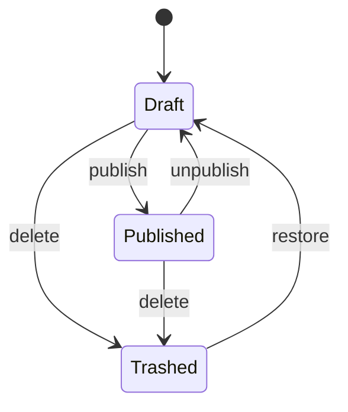
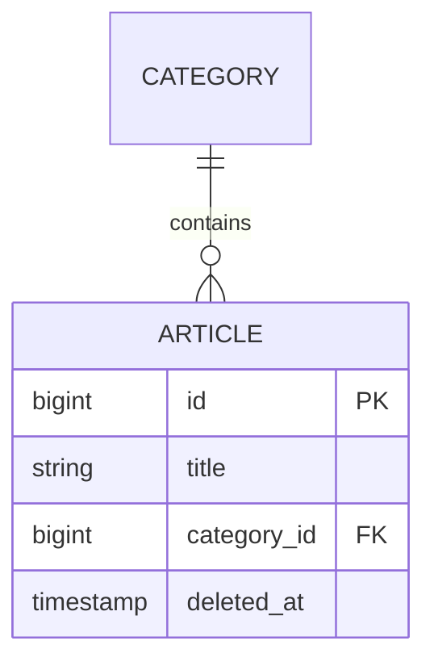

# Thiết kế trước khi làm — use case, luồng, ERD, giao diện, API

Bước 4 của [[Quy trình một việc]]: biến yêu cầu đã làm rõ thành đề xuất người giao việc đọc là hiểu và duyệt được. Mẫu thiết kế chi tiết màn hình / API: [[Detail Design]].

Trước: [[Nhận và làm rõ yêu cầu]] · Sau: [[Kế hoạch test cho một việc]].

## Lựa chọn của tôi

- Chỉ làm **loại thiết kế việc cần** (bảng dưới); không vẽ cho đủ bộ.
- Thiết kế **bằng văn bản**: bảng, khung chữ, sơ đồ dạng chữ (ví dụ Mermaid — Obsidian và nhiều nơi lưu repo hiển thị được) để nằm cạnh code, diff được, sửa được.
- Mỗi thiết kế trả lời một câu hỏi, đọc hết trong một màn hình.
- Thiết kế là **đề xuất để duyệt**: ghi giả định và câu hỏi mở; duyệt xong mới sửa code.
- Duyệt xong → đặt vào tài liệu tính năng của dự án (hoặc liên kết tới), không để trôi trong chat; code đổi thì thiết kế đổi theo.

## Cần thiết kế nào

| Việc | Use case | Luồng | ERD | Giao diện | API |
|---|---|---|---|---|---|
| Tính năng mới nhiều lớp | ✔ | ✔ | Khi đổi DB | Khi có màn hình | ✔ |
| Thêm / đổi bảng, cột | — | — | ✔ | — | Khi API đổi |
| Màn hình mới / đổi lớn | — | Khi nhiều bước | — | ✔ | Khi gọi API mới |
| Quy trình nhiều trạng thái (duyệt, đơn hàng) | ✔ | ✔ trạng thái | ✔ | — | — |
| Tích hợp dịch vụ ngoài, việc nền | — | ✔ tuần tự | — | — | ✔ |
| Sửa lỗi, việc nhỏ | — | — | — | — | — |

Loại bỏ qua → một câu vì sao.

## 1. Use case

| Mục | Nội dung |
|---|---|
| Tên | Động từ + đối tượng ("Khôi phục bài viết từ thùng rác") |
| Tác nhân | Vai trò, không phải tên người |
| Điều kiện trước | Đăng nhập, quyền, trạng thái dữ liệu |
| Luồng chính | Bước đánh số: người dùng làm → hệ thống phản hồi |
| Luồng phụ / lỗi | 2a, 3a…: khi nào, hệ thống làm gì, thông báo gì |
| Điều kiện sau | Dữ liệu / trạng thái sau khi xong |
| Quy tắc nghiệp vụ | Giới hạn, công thức, ai thấy gì |

- [ ] Mỗi luồng lỗi có thông báo / mã lỗi tương ứng.
- [ ] Quyền ghi ở điều kiện trước và được kiểm ở server.

## 2. Luồng

| Sơ đồ | Dùng khi |
|---|---|
| Lưu đồ | Nhiều nhánh quyết định |
| Tuần tự | Nhiều phần gọi nhau: giao diện → API → DB → dịch vụ ngoài / hàng đợi |
| Trạng thái | Đối tượng có vòng đời |



- [ ] Mỗi mũi tên có tên hành động; chuyển không cho phép → ghi lỗi trả về.
- [ ] Sơ đồ tuần tự chỉ rõ: phần nào trong giao dịch, phần nào sau khi commit (email, hàng đợi), chỗ nào có thể hỏng giữa chừng và xử lý ra sao.

## 3. ERD



Mỗi bảng mới / đổi kèm bảng cột:

| Cột | Kiểu | Null | Mặc định | Ràng buộc / index | Ghi chú |
|---|---|---|---|---|---|

- [ ] Khoá chính, khoá ngoại và hành vi khi bản ghi cha bị xoá.
- [ ] Mọi luật "không trùng" có unique ở DB, không chỉ kiểm ở code.
- [ ] Index cho cột dùng để lọc, sắp xếp, nối bảng.
- [ ] Xoá mềm hay xoá hẳn ([[Thùng rác và xoá]]); cột thời gian, người tạo / sửa nếu cần.
- [ ] Dữ liệu đang có chuyển thế nào; migration quay lui được không ([[Dữ liệu và DB]]).
- [ ] Tên bảng / cột theo quy ước dự án.

## 4. Giao diện

Khung chữ đủ thấy bố cục; ảnh / công cụ thiết kế nếu nhóm có.

```
┌ Tên trang ................................ [+ Thêm] ┐
│ [Tìm kiếm________]  [Trạng thái ▾]                  │
│ Tên            | Trạng thái | Cập nhật   | ⋯        │
│ …                                                    │
│                                    ‹ 1 2 3 ›         │
└──────────────────────────────────────────────────────┘
```

| Mục | Ghi |
|---|---|
| Trạng thái | Tải, rỗng, lỗi, không có quyền, thành công ([[Trạng thái, form và bảng]]) |
| Thao tác | Nút → hành động → có xác nhận không ([[Dialog và hộp xác nhận]]) → thông báo ([[Thông báo và hiển thị lỗi]]) |
| Form | Trường, bắt buộc, luật validate, lỗi hiện ở đâu |
| Kích thước | Điện thoại / máy tính bảng / máy tính |
| Ngôn ngữ | Chữ đi qua đa ngôn ngữ; chữ dài nhất có vỡ khung không |
| Truy cập | Bàn phím, nhãn, tương phản ([[Bố cục, màu và truy cập dễ dàng]]) |

## 5. API

| Phương thức + đường dẫn | Quyền | Đầu vào (luật validate) | Thành công | Lỗi (mã HTTP + mã lỗi) |
|---|---|---|---|---|

Khung phản hồi theo [[Giao dịch, lỗi và phản hồi API]]; đổi hợp đồng → [[Hợp đồng API giữa các phần]].

## Checklist

- [ ] Chỉ có loại thiết kế việc cần; loại bỏ qua có lý do.
- [ ] Mỗi thiết kế khớp tiêu chí chấp nhận ([[Nhận và làm rõ yêu cầu]]).
- [ ] Luồng lỗi và quyền có mặt trong use case / luồng / API.
- [ ] Đổi DB có ERD + bảng cột + cách chuyển dữ liệu + đường quay lui.
- [ ] Giao diện có đủ trạng thái, không chỉ "có dữ liệu".
- [ ] Thiết kế đã duyệt nằm trong tài liệu dự án.

## Bẫy

- Sơ đồ đẹp nhưng thiếu luồng lỗi.
- ERD quên dữ liệu đang có và đường quay lui.
- Thiết kế không cập nhật khi code đổi → sai còn tệ hơn không có.
